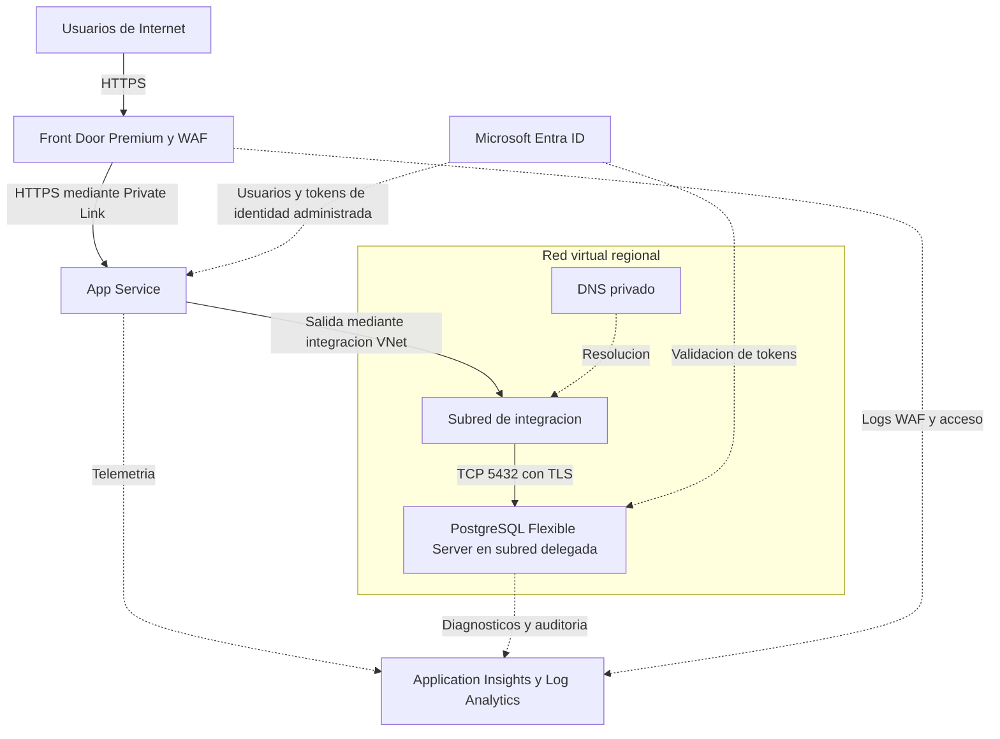

# Arquitectura

## Estado y alcance

Diseño inicial, no implementado. Se confirmó PostgreSQL Flexible Server, aplicación pública y documentación antes de IaC. La topología siguiente es una recomendación técnica; los servicios adicionales y sus costos requieren aprobación antes de implementar.

Se busca una aplicación web PaaS reutilizable, con separación entre entrada pública, cómputo y datos. No se incluyen migración de sistemas existentes, una landing zone completa ni recuperación multirregión implementada.

## Topología recomendada

App Service no se despliega dentro de la subred de integración: esta habilita sus conexiones salientes. Private Link protege el ingreso desde Front Door y es independiente de la integración VNet.

## Componentes y límites de confianza

| Componente | Responsabilidad y decisión propuesta |
| --- | --- |
| Front Door Premium + WAF | Única entrada pública HTTPS. Reglas administradas, rate limiting y WAF en prevención tras ajustar falsos positivos. Private Link al origen evita bypass público. |
| App Service | Plan dedicado compatible con red privada; runtime por definir. HTTPS Only, TLS 1.2+, identidad administrada, autenticación Entra y autorización de aplicación. Deshabilitar acceso público directo al origen. |
| VNet y subred de aplicación | Subred dedicada delegada a `Microsoft.Web/serverFarms`, sin compartir con PostgreSQL ni private endpoints. Planificar capacidad para escalado y actualizaciones. |
| PostgreSQL Flexible Server | Acceso privado por integración VNet en otra subred, delegada a `Microsoft.DBforPostgreSQL/flexibleServers`. Sin endpoint público accesible; Entra-only recomendado. |
| DNS privado | Zona compatible con el modo de integración VNet de PostgreSQL, con sufijo `.postgres.database.azure.com`, vinculada a las redes consumidoras. No confundir con la zona del modo Private Link. |
| Observabilidad | Application Insights basado en workspace, Log Analytics, diagnósticos por servicio, Activity Log y alertas. Destinos y retenciones parametrizables. |
| Key Vault, si se requiere | Solo para secretos o certificados adicionales; no es necesario para guardar una contraseña PostgreSQL cuando se usa Entra-only. Acceso privado, RBAC y protección de eliminación según requisitos. |

El Private Link de Front Door utiliza infraestructura administrada por Front Door, no la subred de integración de la aplicación. La administración o publicación privada por SCM puede requerir un private endpoint adicional en una subred no delegada y su DNS para el runner; se diseñará con el pipeline.

## Flujos

1. El usuario llega por HTTPS a Front Door; el WAF inspecciona la solicitud. El servicio reenvía al origen por HTTPS y Private Link, con validación de certificado y encabezado de host correcto.
2. App Service autentica al usuario con Entra ID y aplica autorización. Se definirán audiencia, registro de aplicación, redirects y políticas de sesión. La identidad del usuario no se convierte automáticamente en identidad de base de datos.
3. App Service adquiere un token con su identidad administrada. El administrador Entra debe haber creado el principal correspondiente en PostgreSQL y asignado permisos SQL mínimos al esquema de la aplicación.
4. La aplicación resuelve el FQDN de PostgreSQL a una dirección privada y conecta por TCP 5432 con TLS y validación de nombre. Los tokens se renuevan para nuevas conexiones del pool.
5. Los servicios emiten telemetría filtrada y diagnósticos. La auditoría PostgreSQL requiere configurar `pgaudit` y sus categorías, no solo habilitar un destino de logs.

## Red y dependencias

- La aplicación, la VNet integrada y PostgreSQL estarán en la misma región en el diseño inicial; comprobar capacidad y características GA en la región elegida.
- Dimensionar la subred de integración según escalado y capacidad temporal de actualización; `/26` es una referencia inicial, no un rango asignado. Aprobar direccionamiento sin solapamientos antes de IaC.
- Restringir PostgreSQL al tráfico de aplicación y administración autorizada. Conservar los flujos internos de HA, Storage, DNS y Entra requeridos por el servicio; evitar reglas NSG o UDR que los interrumpan.
- Usar FQDN, nunca IP fija, para PostgreSQL. Si hay DNS corporativo, planificar reenvío y resolución desde la aplicación y runners.
- No combinar sin revisión la integración VNet de PostgreSQL con el modo alternativo Private Link. Un cambio de modelo de red puede requerir recreación o migración.
- La integración VNet no filtra por sí sola toda la salida a Internet. Si se exige inspección de egress, diseñar rutas y firewall con las excepciones de plataforma necesarias; NAT por sí solo no es un firewall.
- Aprobar explícitamente la conexión privada de Front Door. No exponer SCM ni habilitar credenciales básicas de publicación para resolver problemas de despliegue.

## Calidad arquitectónica

| Pilar | Criterio de diseño |
| --- | --- |
| Seguridad | Única entrada WAF, origen y datos privados, mínimo privilegio, Entra, TLS y auditoría. |
| Confiabilidad | Health checks, reconexión, backups y pruebas de restauración. HA zonal para producción si la región y SKU lo admiten y se aprueba el costo. |
| Rendimiento | Autoscaling con límites; pool total compatible con conexiones PostgreSQL; medir latencia, carga y saturación antes de dimensionar. |
| Operación | IaC reproducible, cambios revisados, observabilidad y runbooks verificables. |
| Costo | Presupuestar Front Door Premium/WAF, planes, HA, almacenamiento, logs, tráfico y runners. No fijar precios ni SKU sin región y carga. |

La propuesta es de una sola región: Front Door global no elimina un fallo regional de la aplicación o de PostgreSQL. Backups y HA no sustituyen una estrategia de recuperación ante desastres. No se promete SLA, RTO o RPO sin diseño y pruebas.

## Decisiones pendientes antes de implementar

| Decisión | Criterio de cierre |
| --- | --- |
| Entrada y presupuesto | Aprobar Front Door Premium + Private Link, o documentar otra entrada WAF sin bypass del origen. No habilitar exposición directa sin revisión. |
| Región y disponibilidad | Definir residencia, capacidad GA, HA, número de instancias y alcance regional. |
| Usuarios y runtime | Seleccionar lenguaje/runtime GA, audiencia Entra y reglas de autorización. Acceso anónimo solo mediante excepción explícita. |
| Continuidad | Acordar RTO, RPO, retenciones, restauración y necesidad de DR multirregión. |
| Integración y permisos | Definir red/DNS existentes o nuevos, scope de despliegue y bootstrap de roles SQL sin administrador permanente en la aplicación. |
| Automatización | Seleccionar runners con acceso privado a SCM y PostgreSQL; definir aprobaciones y permisos OIDC. |
| Operación | Asignar responsable técnico, umbrales, destino de auditoría y tratamiento de información sensible. |

## Referencias oficiales

- [Integración VNet de App Service](https://learn.microsoft.com/en-us/azure/app-service/overview-vnet-integration).
- [Front Door Premium con Private Link a App Service](https://learn.microsoft.com/en-us/azure/frontdoor/standard-premium/how-to-enable-private-link-web-app).
- [Red privada de PostgreSQL Flexible Server](https://learn.microsoft.com/en-us/azure/postgresql/network/concepts-networking-private).
- [Autenticación Entra de PostgreSQL](https://learn.microsoft.com/en-us/azure/postgresql/security/security-entra-concepts).
- [Azure Well-Architected Framework](https://learn.microsoft.com/en-us/azure/well-architected/).

Revalidar disponibilidad GA, restricciones y costos antes de implementar; esta documentación no sustituye la validación de la configuración desplegada.